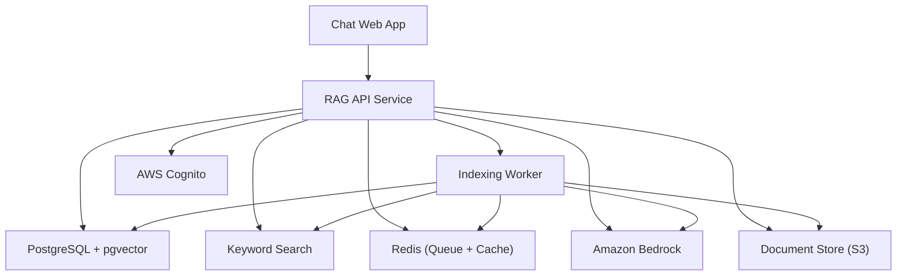
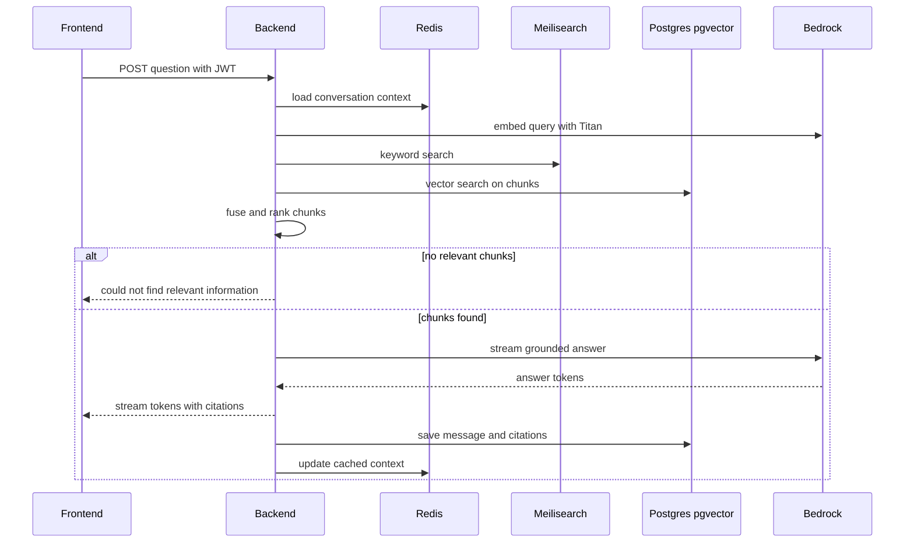
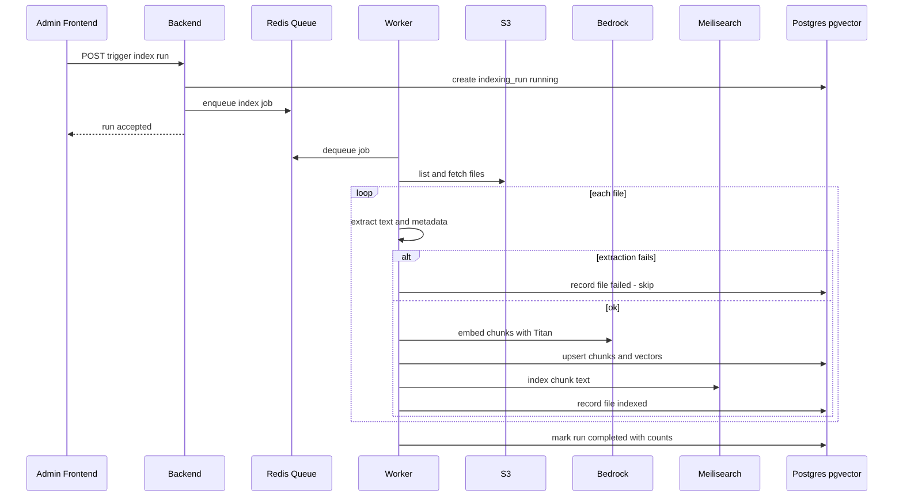
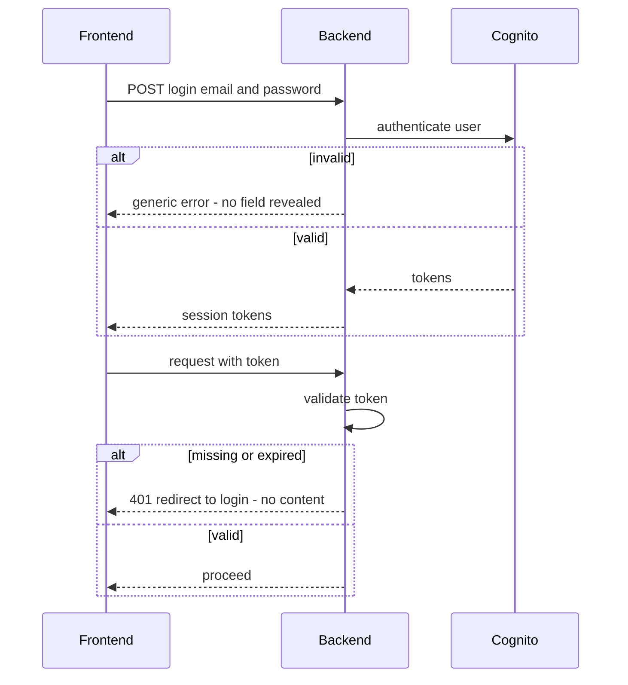
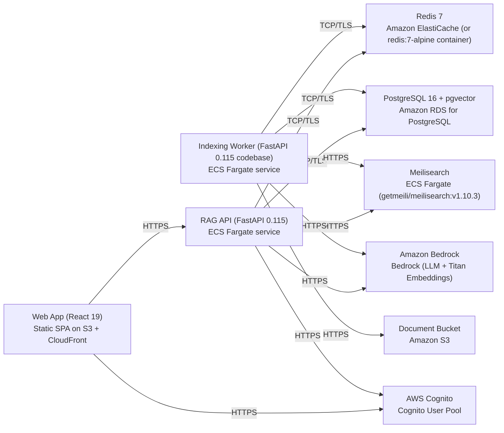

# Architecture

> Maintained by QuorQ AI SDLC. Text between `sdlc:auto` markers is regenerated; anything outside them is yours and is kept.

<!-- sdlc:auto:start narrative -->
## Overview

### ARCH-OVERVIEW · approved · source: architecture:summary

Approved v1 architecture for an all-AWS Hybrid RAG chatbot for internal staff, combining keyword and semantic retrieval over a single S3 document source, with a React SPA frontend and FastAPI backend/worker.

Version 1, status approved. A React 19 SPA provides a responsive, streaming chat interface with clickable source citations and an admin indexing view. A FastAPI 0.115 backend authenticates staff via AWS Cognito, orchestrates hybrid retrieval (Meilisearch keyword search plus pgvector semantic search over Amazon Bedrock Titan embeddings), and streams grounded answers from Amazon Bedrock. A background worker driven by a Redis queue reads documents from the single S3 bucket, extracts text/metadata from PDF/Word/Markdown/text and CSV/JSON/notebook files, chunks and embeds them, and populates keyword and vector indexes. PostgreSQL 16 stores users, conversations, messages, citations, document/index status and embeddings (pgvector); Redis also caches conversation state and frequent query/embedding results. Internal documents, embeddings and answers stay inside the organization's AWS environment.

- ⚠ No requirements-phase input was provided alongside this architecture, so it is not possible to confirm which of US-001..US-013 each architectural decision satisfies.

### ARCH-COMP-FRONTEND · approved · source: architecture:components:frontend

Chat Web App built as a React 19 single-page application.

Component 'frontend' (Chat Web App, React 19): a responsive SPA for authenticated chat with live streaming answers, clickable source citations, conversation history, and an admin indexing-status view. Deployed as a static SPA on S3 + CloudFront.

### ARCH-COMP-BACKEND · approved · source: architecture:components:backend

RAG API Service built on FastAPI 0.115 as the central orchestration layer.

Component 'backend' (RAG API Service, FastAPI 0.115): authenticates requests via Cognito, manages conversations/messages, runs hybrid retrieval, calls Bedrock for grounded streamed answers, and enqueues indexing jobs. Deployed as an ECS Fargate service running Python 3.12 / Uvicorn.

### ARCH-COMP-WORKER · approved · source: architecture:components:worker

Indexing Worker consumes background jobs to populate the search and vector indexes from S3 documents.

Component 'worker' (Indexing Worker, FastAPI 0.115 codebase): consumes indexing jobs from Redis, reads files from S3, extracts text/metadata, chunks content, calls Bedrock Titan for embeddings, and writes to pgvector and Meilisearch while recording per-file status. Deployed as an ECS Fargate service running Python 3.12 as an RQ worker.

### ARCH-COMP-DB · approved · source: architecture:components:db

PostgreSQL 16 with pgvector is the single system of record for application data and embeddings.

Component 'db' (PostgreSQL + pgvector, PostgreSQL 16): stores users, conversations, messages, citations, documents, chunks with embeddings, and indexing-run status in one system -- avoiding a separate dedicated vector database. Deployed as Amazon RDS for PostgreSQL 16.

### ARCH-COMP-SEARCH · approved · source: architecture:components:search

Meilisearch provides the lexical/keyword half of hybrid retrieval.

Component 'search' (Keyword Search, Meilisearch v1.10.3): matches exact terms, filenames and identifiers over document chunks as the lexical counterpart to semantic (pgvector) retrieval. Deployed as an ECS Fargate container (getmeili/meilisearch:v1.10.3).

### ARCH-COMP-REDIS · approved · source: architecture:components:redis

Redis backs the indexing job queue and conversation/query caching.

Component 'redis' (Redis Queue + Cache, Redis 7): backs the background indexing job queue and caches multi-turn conversation state plus frequent query/embedding results. Deployed on Amazon ElastiCache (or a redis:7-alpine container).

### ARCH-COMP-S3 · approved · source: architecture:components:s3

A single S3 bucket is the sole, authoritative source of organizational documents.

Component 's3' (Document Store, Amazon S3): the single, sole source of documents; the worker reads supported files (PDF/Word/Markdown/text and CSV/JSON/notebook) from this one bucket. Deployed as a managed Amazon S3 bucket (Document Bucket).

### ARCH-COMP-BEDROCK · approved · source: architecture:components:bedrock

Amazon Bedrock generates grounded answers and produces Titan embeddings, keeping data inside AWS.

Component 'bedrock' (Amazon Bedrock): generates grounded, cited answers from retrieved chunks and produces Titan embeddings, keeping documents within AWS. Deployed as a managed Bedrock service (LLM + Titan Embeddings).

### ARCH-COMP-COGNITO · approved · source: architecture:components:cognito

AWS Cognito authenticates staff and issues tokens validated on every backend request.

Component 'cognito' (AWS Cognito): authenticates staff via email/password and issues tokens the backend validates on every request. Deployed as a managed Cognito User Pool.

### ARCH-CP-ASK · approved · source: architecture:critical_paths:Ask a question (hybrid retrieval + grounded answer)

Core chat flow: an authenticated question triggers hybrid retrieval and a streamed, cited answer.

An authenticated staff member asks a question; the backend builds context from conversation history, runs keyword (Meilisearch) and semantic (pgvector) retrieval, fuses the results, and streams a grounded, cited answer from Bedrock.

**Related:** ARCH-COMP-BACKEND, ARCH-COMP-SEARCH, ARCH-COMP-DB, ARCH-COMP-BEDROCK

### ARCH-CP-INDEX · approved · source: architecture:critical_paths:Build index from S3 (manual run)

Admin-triggered pipeline that reads the S3 bucket and rebuilds both search indexes.

An admin triggers an indexing run; the backend enqueues a job, the worker lists the bucket, extracts text/metadata per file, chunks, embeds, and writes to pgvector and Meilisearch, recording per-file success/skip/failure.

**Related:** ARCH-COMP-WORKER, ARCH-COMP-S3, ARCH-COMP-DB, ARCH-COMP-SEARCH

### ARCH-CP-AUTH · approved · source: architecture:critical_paths:Authenticated access enforcement

Every chat and answer request requires a valid Cognito token.

Every chat and answer request must carry a valid Cognito token; unauthenticated or expired requests get no content and are redirected to login.

**Related:** ARCH-COMP-COGNITO, ARCH-COMP-BACKEND

### ARCH-DATA-MODEL · approved · source: architecture:entities

Relational schema covering users, conversations, messages, citations, documents, chunks and indexing runs.

Entities: users(id, cognito_sub, email, created_at); conversations(id, user_id, title, created_at, updated_at); messages(id, conversation_id, role, content, created_at); citations(id, message_id, document_id, chunk_id, filename, location); documents(id, s3_key, filename, file_type, status, error, indexed_at, last_run_id); chunks(id, document_id, chunk_index, content, metadata, embedding, meili_id); indexing_runs(id, status, files_total, files_indexed, files_failed, started_at, completed_at).

**Related:** ARCH-COMP-DB

### ARCH-API · approved · source: architecture:endpoints

Backend API surface covering auth, conversations, chat messaging, and admin indexing control.

Endpoints: POST /auth/login (authenticate via Cognito, returns session tokens; failure returns one generic error that does not reveal which field was wrong); POST /auth/logout (invalidate current session); GET /conversations (list signed-in user's conversations); POST /conversations (create a new conversation); GET /conversations/{id}/messages (ordered messages with citations); POST /conversations/{id}/messages (submit a question, runs hybrid retrieval, streams a grounded SSE answer with citations using prior turns as context, returns a no-match message when nothing relevant is found); POST /admin/index/runs (trigger a manual on-demand indexing run, enqueues background work); GET /admin/index/status (running flag, files indexed, skipped/failed files, last completion time).

**Related:** ARCH-COMP-BACKEND, ARCH-COMP-COGNITO

### ARCH-DEPLOY · approved · source: architecture:deployment_nodes

All components run as managed or containerized AWS services.

Deployment topology: Web App (React 19) as a static SPA on S3 + CloudFront; RAG API (FastAPI 0.115) as an ECS Fargate service on Python 3.12/Uvicorn; Indexing Worker (FastAPI 0.115 codebase) as an ECS Fargate service running as an RQ worker on Python 3.12; PostgreSQL 16 + pgvector on Amazon RDS; Meilisearch as an ECS Fargate container (getmeili/meilisearch:v1.10.3); Redis 7 on Amazon ElastiCache (or a redis:7-alpine container); Document Bucket as managed Amazon S3; Amazon Bedrock (LLM + Titan Embeddings) as a managed service; AWS Cognito as a managed Cognito User Pool.

**Related:** ARCH-COMP-FRONTEND, ARCH-COMP-BACKEND, ARCH-COMP-WORKER, ARCH-COMP-DB, ARCH-COMP-SEARCH, ARCH-COMP-REDIS, ARCH-COMP-S3, ARCH-COMP-BEDROCK, ARCH-COMP-COGNITO

### ARCH-TECH-DECISIONS · approved · source: architecture:technology_decisions

Key technology choices and their rationale versus considered alternatives.

Frontend: React 19 (vs. Vue, Svelte) chosen to deliver the responsive chat SPA with live SSE streaming, clickable citations and an admin indexing view using React's mature ecosystem. Backend: FastAPI 0.115 (vs. Flask, Django) chosen so one Python service covers extraction, chunking, embedding calls, hybrid retrieval orchestration and streaming responses, aligning with the org's data-science ecosystem. Database: PostgreSQL 16 (vs. MySQL, a dedicated vector database) chosen to hold users, conversations, messages, citations and indexing status, and with pgvector also store embeddings, avoiding a separate vector DB at tens-of-thousands-of-documents scale. Cloud: AWS (vs. Azure, GCP) chosen because documents already live in S3 and Bedrock plus Cognito run natively there, keeping data next to its source and all documents, embeddings and answers inside the org's AWS environment.
<!-- sdlc:auto:end narrative -->

<!-- sdlc:auto:start building-blocks -->
## Building Block View

| ID | Name | Technology | Responsibility | Depends on |
|---|---|---|---|---|
| frontend | Chat Web App | React 19 | Responsive React SPA for authenticated chat with live streaming answers, clickable source citations, conversation history and an admin indexing-status view. | backend |
| backend | RAG API Service | FastAPI 0.115 | Authenticates requests via Cognito, manages conversations/messages, runs hybrid retrieval, calls Bedrock for grounded streamed answers, and enqueues indexing jobs. | db, search, redis, bedrock, cognito, s3, worker |
| worker | Indexing Worker | FastAPI 0.115 | Consumes indexing jobs from Redis, reads files from S3, extracts text/metadata, chunks, calls Bedrock Titan for embeddings, and writes to pgvector and Meilisearch while recording per-file status. | db, search, redis, bedrock, s3 |
| db | PostgreSQL + pgvector | PostgreSQL 16 | Stores users, conversations, messages, citations, documents, chunks with embeddings, and indexing-run status in one system. | — |
| search | Keyword Search | Meilisearch v1.10.3 | Lexical/keyword half of hybrid retrieval over document chunks, matching exact terms, filenames and identifiers. | — |
| redis | Redis (Queue + Cache) | Redis 7 | Backs the background indexing job queue and caches multi-turn conversation state and frequent query/embedding results. | — |
| s3 | Document Store (S3) | Amazon S3 | The single, sole source of documents; the worker reads supported files from this one bucket. | — |
| bedrock | Amazon Bedrock | Amazon Bedrock | Generates grounded, cited answers from retrieved chunks and produces Titan embeddings, keeping documents within AWS. | — |
| cognito | AWS Cognito | AWS Cognito | Authenticates staff via email/password and issues tokens the backend validates on every request. | — |

<!-- sdlc:auto:end building-blocks -->

<!-- sdlc:auto:start runtime -->
## Runtime View

### Ask a question (hybrid retrieval + grounded answer)

An authenticated staff member asks a question; the backend builds context from conversation history, runs keyword + semantic retrieval, fuses results, and streams a grounded, cited answer from Bedrock.

- **Components:** frontend, backend, redis, search, db, bedrock
- **Modules:** chat_router, retrieval_service, fusion, bedrock_client, conversation_cache
- **Key functions:** post_message(conversation_id, question), embed_query(text), keyword_search(query, k), vector_search(query_embedding, k), fuse_results(keyword_hits, vector_hits), stream_answer(context_chunks, history)

### Build index from S3 (manual run)

An admin triggers an indexing run; the backend enqueues a job, the worker lists the bucket, extracts text/metadata per file, chunks, embeds, and writes to pgvector and Meilisearch, recording per-file success/skip/failure.

- **Components:** frontend, backend, redis, worker, s3, bedrock, search, db
- **Modules:** admin_router, index_queue, extractors, chunker, embedder, index_writer
- **Key functions:** trigger_index_run(), enqueue_index_job(run_id), list_bucket_objects(bucket), extract_text(file_bytes, file_type), chunk_text(text, size, overlap), embed_chunks(chunks), write_indexes(chunks, embeddings), record_file_status(run_id, key, status, error)

### Authenticated access enforcement

Every chat and answer request must carry a valid Cognito token; unauthenticated or expired requests get no content and are sent to login.

- **Components:** frontend, backend, cognito
- **Modules:** auth_router, auth_dependency, cognito_client
- **Key functions:** login(email, password), validate_token(jwt), require_staff(request)

<!-- sdlc:auto:end runtime -->

<!-- sdlc:auto:start deployment-view -->
## Deployment View

| Name | Service | Runtime | Scaling | Environment |
|---|---|---|---|---|
| Web App (React 19) | Static SPA on S3 + CloudFront | Static assets | CDN edge | dev |
| RAG API (FastAPI 0.115) | ECS Fargate service | Python 3.12 / Uvicorn | 1-3 tasks | dev |
| Indexing Worker (FastAPI 0.115 codebase) | ECS Fargate service | Python 3.12 / RQ worker | 1-2 tasks | dev |
| PostgreSQL 16 + pgvector | Amazon RDS for PostgreSQL | PostgreSQL 16 | single instance | dev |
| Meilisearch | ECS Fargate (getmeili/meilisearch:v1.10.3) | Container | single task | dev |
| Redis 7 | Amazon ElastiCache (or redis:7-alpine container) | Redis 7 | single node | dev |
| Document Bucket | Amazon S3 | Managed | managed | dev |
| Amazon Bedrock | Bedrock (LLM + Titan Embeddings) | Managed | managed | dev |
| AWS Cognito | Cognito User Pool | Managed | managed | dev |

| Source | Target | Protocol |
|---|---|---|
| Web App (React 19) | RAG API (FastAPI 0.115) | HTTPS |
| Web App (React 19) | AWS Cognito | HTTPS |
| RAG API (FastAPI 0.115) | PostgreSQL 16 + pgvector | TCP/TLS |
| RAG API (FastAPI 0.115) | Meilisearch | HTTPS |
| RAG API (FastAPI 0.115) | Redis 7 | TCP/TLS |
| RAG API (FastAPI 0.115) | Amazon Bedrock | HTTPS |
| RAG API (FastAPI 0.115) | AWS Cognito | HTTPS |
| Indexing Worker (FastAPI 0.115 codebase) | Redis 7 | TCP/TLS |
| Indexing Worker (FastAPI 0.115 codebase) | Document Bucket | HTTPS |
| Indexing Worker (FastAPI 0.115 codebase) | Amazon Bedrock | HTTPS |
| Indexing Worker (FastAPI 0.115 codebase) | PostgreSQL 16 + pgvector | TCP/TLS |
| Indexing Worker (FastAPI 0.115 codebase) | Meilisearch | HTTPS |

<!-- sdlc:auto:end deployment-view -->

<!-- sdlc:auto:start decisions -->
## Architecture Decisions

| Layer | Choice | ADR |
|---|---|---|
| Frontend | React 19 | [ADR-0001](adr/frontend.md) |
| Backend | FastAPI 0.115 | [ADR-0002](adr/backend.md) |
| Database | PostgreSQL 16 | [ADR-0003](adr/database.md) |
| Cloud | AWS | [ADR-0004](adr/cloud.md) |
<!-- sdlc:auto:end decisions -->

<!-- sdlc:auto:start links -->
## Related Documents

- [Data Model](data-model.md)
- [API Specification](api/openapi.yaml)
- [Architecture Decision Records](adr/README.md)
<!-- sdlc:auto:end links -->
