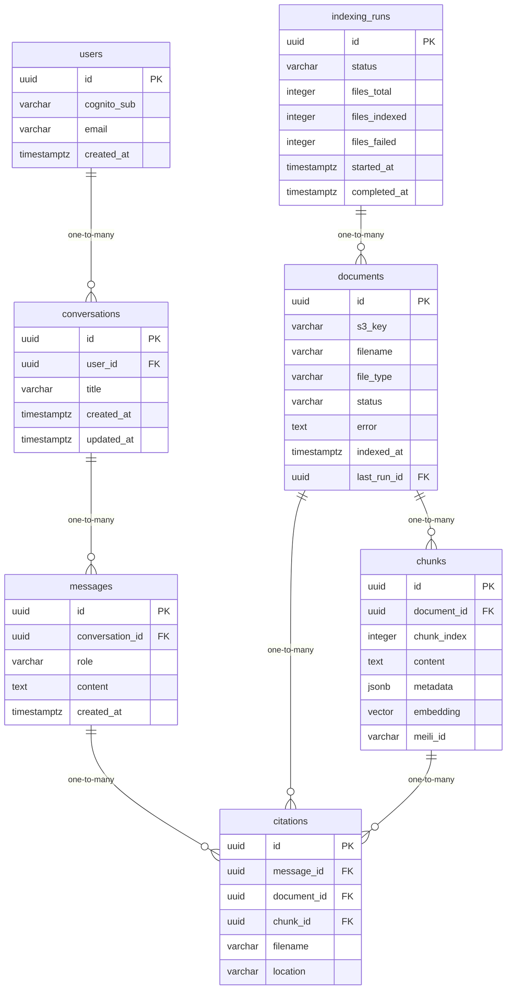

# Data Model

<!-- sdlc:auto:start entities -->
### users

| Field | Type | PK | FK | Nullable |
|---|---|---|---|---|
| id | uuid | True | — | False |
| cognito_sub | varchar | False | — | False |
| email | varchar | False | — | False |
| created_at | timestamptz | False | — | False |

### conversations

| Field | Type | PK | FK | Nullable |
|---|---|---|---|---|
| id | uuid | True | — | False |
| user_id | uuid | False | users.id | False |
| title | varchar | False | — | True |
| created_at | timestamptz | False | — | False |
| updated_at | timestamptz | False | — | False |

### messages

| Field | Type | PK | FK | Nullable |
|---|---|---|---|---|
| id | uuid | True | — | False |
| conversation_id | uuid | False | conversations.id | False |
| role | varchar | False | — | False |
| content | text | False | — | False |
| created_at | timestamptz | False | — | False |

### citations

| Field | Type | PK | FK | Nullable |
|---|---|---|---|---|
| id | uuid | True | — | False |
| message_id | uuid | False | messages.id | False |
| document_id | uuid | False | documents.id | False |
| chunk_id | uuid | False | chunks.id | True |
| filename | varchar | False | — | False |
| location | varchar | False | — | True |

### documents

| Field | Type | PK | FK | Nullable |
|---|---|---|---|---|
| id | uuid | True | — | False |
| s3_key | varchar | False | — | False |
| filename | varchar | False | — | False |
| file_type | varchar | False | — | False |
| status | varchar | False | — | False |
| error | text | False | — | True |
| indexed_at | timestamptz | False | — | True |
| last_run_id | uuid | False | indexing_runs.id | True |

### chunks

| Field | Type | PK | FK | Nullable |
|---|---|---|---|---|
| id | uuid | True | — | False |
| document_id | uuid | False | documents.id | False |
| chunk_index | integer | False | — | False |
| content | text | False | — | False |
| metadata | jsonb | False | — | True |
| embedding | vector | False | — | True |
| meili_id | varchar | False | — | True |

### indexing_runs

| Field | Type | PK | FK | Nullable |
|---|---|---|---|---|
| id | uuid | True | — | False |
| status | varchar | False | — | False |
| files_total | integer | False | — | True |
| files_indexed | integer | False | — | True |
| files_failed | integer | False | — | True |
| started_at | timestamptz | False | — | False |
| completed_at | timestamptz | False | — | True |
<!-- sdlc:auto:end entities -->

<!-- sdlc:auto:start relationships -->
| Source | Target | Type |
|---|---|---|
| users | conversations | one-to-many |
| conversations | messages | one-to-many |
| messages | citations | one-to-many |
| documents | chunks | one-to-many |
| documents | citations | one-to-many |
| chunks | citations | one-to-many |
| indexing_runs | documents | one-to-many |
<!-- sdlc:auto:end relationships -->

<!-- sdlc:auto:start er-diagram -->

<!-- sdlc:auto:end er-diagram -->
