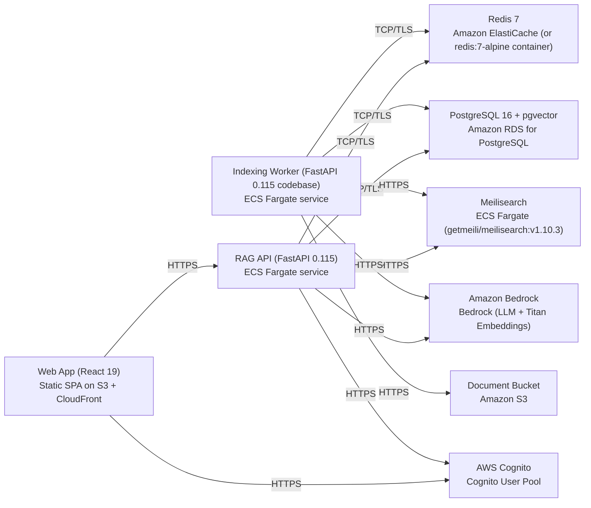

# Deployment Guide

> Maintained by QuorQ AI SDLC. Text between `sdlc:auto` markers is regenerated; anything outside them is yours and is kept.

<!-- sdlc:auto:start how-it-deploys -->
Pushes to `main` run `.github/workflows/deploy.yml`, which builds the API image (if there is a backend) and deploys the SPA to AWS Amplify. Commits touching only `docs/sdlc/**` don't deploy. Deployments can also be started from the platform's Deployment tab.
<!-- sdlc:auto:end how-it-deploys -->

<!-- sdlc:auto:start environments -->
| Name | Service | Runtime | Scaling | Environment |
|---|---|---|---|---|
| Web App (React 19) | Static SPA on S3 + CloudFront | Static assets | CDN edge | dev |
| RAG API (FastAPI 0.115) | ECS Fargate service | Python 3.12 / Uvicorn | 1-3 tasks | dev |
| Indexing Worker (FastAPI 0.115 codebase) | ECS Fargate service | Python 3.12 / RQ worker | 1-2 tasks | dev |
| PostgreSQL 16 + pgvector | Amazon RDS for PostgreSQL | PostgreSQL 16 | single instance | dev |
| Meilisearch | ECS Fargate (getmeili/meilisearch:v1.10.3) | Container | single task | dev |
| Redis 7 | Amazon ElastiCache (or redis:7-alpine container) | Redis 7 | single node | dev |
| Document Bucket | Amazon S3 | Managed | managed | dev |
| Amazon Bedrock | Bedrock (LLM + Titan Embeddings) | Managed | managed | dev |
| AWS Cognito | Cognito User Pool | Managed | managed | dev |
<!-- sdlc:auto:end environments -->

<!-- sdlc:auto:start live -->
_Not deployed yet._
<!-- sdlc:auto:end live -->

<!-- sdlc:auto:start topology -->

<!-- sdlc:auto:end topology -->
